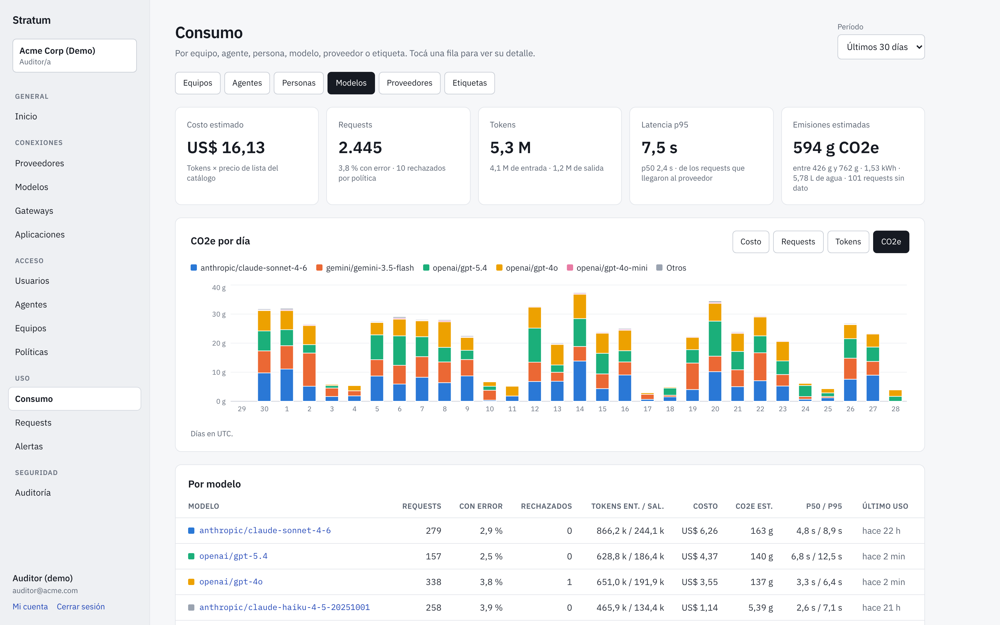
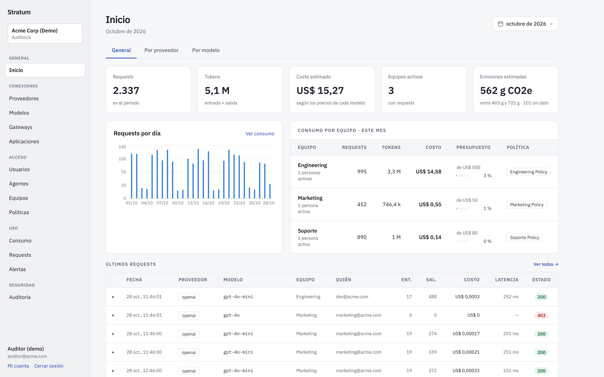
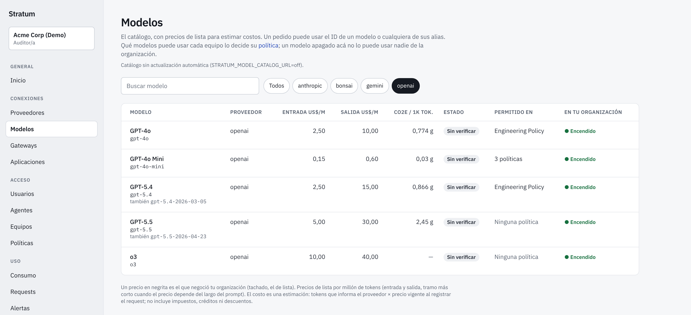

# Stratum

*[Leer en español](README.es.md)*

**An open-source AI gateway that enforces your organization's AI policies
inside your own network, and shows what AI costs you: in money, and in
energy, water and emissions.**



Stratum sits between your applications and LLM providers (OpenAI, Anthropic,
Gemini, Mistral, Groq, Azure OpenAI, Ollama and other OpenAI-compatible
APIs). It authenticates every developer, agent and application, applies each
team's policy, quota and budget, keeps personal data and secrets from
reaching the provider, and forwards the request with your organization's own
provider credentials. Prompts and responses never leave your network except
toward the provider you chose.

## Try it in one command

```sh
git clone https://github.com/getstratum/stratum && cd stratum
make demo
```

Docker is all it needs. You get the console on <http://localhost:3000>, a
gateway, a mock LLM instead of real providers (no keys, nothing is paid) and
a demo organization with four weeks of usage. `make demo-down` removes it.
Details and the demo accounts: [deploy/demo](deploy/demo/README.md).

## What it does

**Control**

- Teams, people, agents and keys; a policy per team with the providers and
  models it may use, a monthly token quota and a budget in US$ that can cut
  requests once it is spent, and a maximum of tokens per request.
- Personal data and secrets found in a prompt are redacted before it reaches
  the provider, or the request is refused, as the policy says.
- An agent can have a fixed model; models can be turned off for the whole
  organization.
- Applications built on the gateway (a chat portal, an internal assistant)
  act **on behalf of people** (`X-Stratum-User`): each person's team policy,
  quota and budget apply, and the usage is theirs. Those applications can
  sign people in with their console account (OpenID Connect).
- **Instructions for people**: a text in the team's policy that the gateway
  puts first in the system instruction of those requests, and the
  application can show.

**Visibility**

- *Consumo*: cost, tokens, errors, requests refused and latency, by team,
  agent, application (on behalf of people), person, model, provider or label (`X-Stratum-Labels`), with a daily
  series.
- **Estimated environmental impact** of every request: energy, water and
  CO2e, as a range, with the method and data of
  [EcoLogits](https://github.com/mlco2/ecologits). Shown in Consumo, per 1,000 tokens in
  Modelos, and on the home page. Models without an estimate are counted as
  missing, never as zero.
- Request logs (metadata only, never prompts) with CSV export, an audit log of every change
  in the console, alerts by email or Slack webhook, a live model catalog
  with prices, and Prometheus metrics with the GenAI semantic conventions.

**Operations**

- The gateway is one Go binary (standard library only). It keeps serving
  when everything but the LLM provider is down: configuration is an
  in-memory snapshot, persisted encrypted, and neither the control plane,
  a database nor Valkey is called on the request path.
- Helm charts for both planes, highly available by default; SLO burn-rate
  alerting rules; a Google Cloud reference deployment with failure tests
  (Stratum: 0 errors in 52,805 requests across a rolling restart, the loss
  of a zone, a database failover and outages of Valkey and the control
  plane, [report](docs/testing/gcp-2026-10-18.md)).
- Signed multi-arch images, SBOM and SLSA provenance on every release.
- Five console roles checked on the server, sessions on the server,
  required second factor for Owner and Admin; sign-in with the
  organization's identity provider (Google Workspace, Entra ID or any
  OpenID Connect provider), to the console and to its applications
  ([docs/console/sso.md](docs/console/sso.md)).

The console speaks Spanish for now; the API, the docs and the code are in
English.

<table>
<tr>
<td></td>
<td></td>
</tr>
</table>

## How it is built

Two planes:

- **Gateway (data plane)**, which runs in your network, next to your
  applications.
- **Control plane**, where you manage teams, keys, policies and providers,
  and see usage. It can run anywhere; gateways only pull configuration from
  it and report usage (metadata only) to it.

See [docs/architecture](docs/architecture/overview.md).

> **Status: pre-release (0.x).** APIs and configuration may still change.
> See the [release checklist](docs/release-checklist.md). Upgrading from an
> earlier release: [docs/upgrading.md](docs/upgrading.md).

## Quick start: standalone gateway

No control plane needed: describe teams, keys and providers in a file.

```sh
# 1. Hash a developer key (the raw key is never stored)
echo -n "my-team-key" | docker run --rm -i ghcr.io/getstratum/stratum-gateway hash-key

# 2. Put the hash in a copy of deploy/standalone/stratum.example.json
cp deploy/standalone/stratum.example.json stratum.json

# 3. Run the gateway
docker run --rm -p 20128:20128 \
  -v "$PWD/stratum.json:/etc/stratum/stratum.json:ro" \
  -e STRATUM_CONFIG_FILE=/etc/stratum/stratum.json \
  -e OPENAI_API_KEY -e ANTHROPIC_API_KEY \
  ghcr.io/getstratum/stratum-gateway

# 4. Point any OpenAI SDK at it
curl http://localhost:20128/v1/chat/completions \
  -H "Authorization: Bearer my-team-key" \
  -d '{"model": "openai/gpt-4o-mini", "messages": [{"role": "user", "content": "Hello"}]}'
```

Send `SIGHUP` to reload the file. A broken file is rejected and the previous
configuration keeps serving.

## Quick start: with the control plane

```sh
cp deploy/compose/.env.example deploy/compose/.env   # fill in the secrets
make up                                              # PostgreSQL + control plane on :3000
```

Then follow the comments in `deploy/compose/docker-compose.yml` to register a
gateway and start it.

## Quick start: Kubernetes (highly available)

```sh
# Control plane: two stateless replicas on your PostgreSQL
helm install stratum-control-plane oci://ghcr.io/getstratum/charts/stratum-control-plane -n stratum \
  --set existingSecret=stratum-control-plane

# Gateways
helm install stratum oci://ghcr.io/getstratum/charts/stratum-gateway -n stratum \
  --set controlPlane.url=https://stratum-cp.example.com \
  --set existingSecret=stratum-gateway
```

Replicas across zones, disruption budgets and zero-capacity-loss rollouts by
default; the gateway drains streams on shutdown and the control plane applies
its database migrations itself. See
[deploy/helm/stratum-control-plane](deploy/helm/stratum-control-plane/README.md)
and [deploy/helm](deploy/helm/README.md) for the gateway.

To try the whole highly available topology on Google Cloud (Terraform, GKE
Autopilot, global load balancer, Cloud SQL HA, Memorystore) and run failure
tests against it, see [deploy/gcp](deploy/gcp/README.md).

## Calling the gateway

| Route | Use |
|---|---|
| `POST /v1/...` | OpenAI-compatible. The provider comes from `"model": "provider/model"`, or from the team policy when it allows a single provider. |
| `POST /proxy/{provider}/...` | Explicit provider, e.g. `/proxy/anthropic/v1/messages` for the Anthropic SDK. |
| `GET /v1/models` | The models the caller may use, in the OpenAI format: the organization's models (from the console's catalog, of the providers it configured, not turned off) that the policy allows. Each `id` is `provider/model`, which `/v1/...` accepts as is. An agent with a fixed model sees only that one. |
| `GET /v1/stratum/instructions` | The instructions for people the gateway adds to the caller's requests (`{"instructions": "...", "id": "..."}`, or nulls): only a key acting for a person, with `X-Stratum-User`, gets any. An application shows them to the person. |
| `GET /livez`, `GET /readyz` | Probes. Readiness depends only on having a configuration and not draining. |
| `GET /metrics` (admin port `:9090`) | Prometheus metrics. Keep the admin port private. |

Developers authenticate with `Authorization: Bearer <key>` or `x-api-key: <key>`.

Any request may carry `X-Stratum-Labels: topic_legal, feature_summaries`: up
to 8 labels of lowercase letters, digits and `_`, which travel with its usage
record and group it in the console's Consumo. A malformed label is refused
with `invalid_labels` rather than dropped, so a typo does not quietly skew
the reports.

An agent can have a **fixed model**, set in the console: every request of
its key goes to that provider and model, whatever model it asks for (it
need not send one), still within the team's policy. The response carries
`X-Stratum-Routed-To: provider/model`. A request in the other API format
(Anthropic Messages against an OpenAI-compatible model, or the other way
around) is refused with `agent_model_mismatch`.

An application built on the gateway (a chat portal, an internal assistant)
can act **on behalf of people**. Its agent is marked in the console as one
that acts for people, and each request names the person with
`X-Stratum-User: <person id>`: the gateway then applies that person's team
policy, quota and budget, and reports the usage as theirs. The ids come from
the people directory each gateway gets in its sync, so the header resolves
without calling the control plane. A key that does not delegate and sends the
header is refused with `delegation_not_allowed`; a person who is not in the
directory, is deactivated, has no team or had access to applications taken
away gets `unknown_user`. Keep such a key on a server, never in a browser:
it can act for anyone in the organization.

The team's policy can carry **instructions for people**: a text the gateway
puts first in the system instruction of those requests (`X-Stratum-Instructions`
in the response names the version), never in an agent's or a key's own. The
application can read them from `GET /v1/stratum/instructions` and show them.
See [Teams, limits and alerts](docs/console/teams.md).

## Gateway configuration

| Variable | Default | Purpose |
|---|---|---|
| `STRATUM_CP_URL` | | Control plane URL (control plane mode). Must be https unless `STRATUM_CP_ALLOW_HTTP=true`. |
| `STRATUM_SYNC_TOKEN`, `STRATUM_INSTANCE_ID` | | Issued when you register the gateway in the control plane. |
| `STRATUM_CONFIG_FILE` | | Standalone mode: path to the configuration file. |
| `STRATUM_SNAPSHOT_KEY` | | 64 hex chars. Enables the encrypted snapshot on disk and, with `STRATUM_VALKEY_URL`, its shared copy in Valkey, so the gateway can start while the control plane is unreachable. |
| `STRATUM_SNAPSHOT_PATH` | `/var/lib/stratum/snapshot.bin` | Where the snapshot is stored. |
| `STRATUM_SNAPSHOT_SHARED` | `true` | Keep the encrypted snapshot in Valkey too, so a new replica can start during a control plane outage. Needs Valkey and the snapshot key. See [Starting without the control plane](#starting-without-the-control-plane). |
| `STRATUM_SNAPSHOT_BOOTSTRAP_TIMEOUT` | `10s` | How long a starting gateway waits for the control plane before it serves the copy in Valkey. |
| `STRATUM_LISTEN_ADDR` / `STRATUM_ADMIN_ADDR` | `:20128` / `:9090` | Public and admin listeners. |
| `STRATUM_SYNC_INTERVAL` / `STRATUM_FULL_RESYNC_INTERVAL` | `30s` / `10m` | Delta sync cadence and full resync cadence. |
| `STRATUM_USAGE_PUSH` | `true` | Control plane mode: report each request's usage (metadata only) to the control plane, for the console's usage, spend and logs (ADR-0009). |
| `STRATUM_USAGE_INTERVAL` / `STRATUM_USAGE_BUFFER` | `10s` / `100000` | How often usage is sent, and how many records are kept while the control plane is unreachable (past that, new ones are dropped and counted). |
| `STRATUM_MAX_INFLIGHT` | `1024` | Concurrent requests before shedding load with 503 + `Retry-After`. |
| `STRATUM_UPSTREAM_HEADER_TIMEOUT` | `120s` | Max wait for the provider's first response byte. |
| `STRATUM_STREAM_IDLE_TIMEOUT` | `60s` | Max silence between streamed chunks. |
| `STRATUM_UPSTREAM_RETRIES` / `STRATUM_UPSTREAM_RETRY_MAX_WAIT` | `2` / `5s` | Retries before the first byte reaches the client, after an error connecting to the provider or a 429/502/503/504 from it, and the most time spent waiting between them (ADR-0010). `0` turns retries off. |
| `STRATUM_RETRY_BUDGET_RATIO` | `0.2` | Retries allowed per request on average, so a provider that is down does not get the traffic multiplied. |
| `STRATUM_BREAKER_THRESHOLD` / `STRATUM_BREAKER_COOLDOWN` | `5` / `30s` | Provider failures in a row after which requests to it are answered at once with 503 `provider_unavailable`, and for how long before a probe. `0` turns the breaker off. |
| `STRATUM_DRAIN_DELAY` / `STRATUM_SHUTDOWN_TIMEOUT` | `5s` / `10m` | Graceful shutdown: readiness fails first, then in-flight streams get up to the timeout to finish. |
| `STRATUM_PII_ENABLED` | `true` | Global switch for PII/DLP scanning (actions are set per policy). |
| `STRATUM_CORS_ALLOWED_ORIGINS` | | Comma-separated origins allowed to call the gateway from a browser. |
| `STRATUM_VALKEY_URL` | | Shared quota counters across replicas and the shared snapshot copy, e.g. `redis://valkey:6379/0` or `rediss://` for TLS. Without it each replica counts on its own. See [Quotas](#quotas-across-replicas). |
| `STRATUM_VALKEY_PASSWORD` | | Overrides the password in the URL, so the URL can live in a ConfigMap. |
| `STRATUM_VALKEY_CA_FILE` | | PEM file with the CA certificates to trust for `rediss://` instead of the system roots, for a Valkey with a private CA (Memorystore with in-transit encryption: every CA from `gcloud memorystore instances get-certificate-authority`). Read at start. |
| `STRATUM_QUOTA_SYNC_INTERVAL` / `STRATUM_QUOTA_STALE_AFTER` | `1s` / `30s` | How often usage is flushed to Valkey, and after how long without a flush the store counts as down. |
| `STRATUM_QUOTA_FAIL_MODE` | `open` | While Valkey is down: `open` keeps enforcing with last known totals plus local usage; `closed` rejects requests of teams that have a quota (503). |

## Quotas across replicas

Monthly token quotas are enforced per team. Each sync also brings the
control plane's count of the team's usage this month, from every gateway, and
the gateway never counts less than that: a restart or a replica on its own
does not reset the month, though it lags by about a minute. With one
replica, local counters are exact. With several, set `STRATUM_VALKEY_URL` so
they share one counter per team in Valkey (or Redis 6.2+):

- Valkey is **never on the request path**. Each replica checks against an
  in-memory total and flushes its usage once per second in a single atomic,
  idempotent script call that also refreshes the totals.
- Overspend is bounded by roughly one flush interval of traffic per replica.
- If Valkey is unreachable, requests keep flowing and each replica keeps
  counting locally; the backlog is written once Valkey returns, exactly once.
  During the outage a replica does not see the others' new usage, so a team
  can go over its quota by up to what the other replicas serve it meanwhile.
  If a quota is a hard billing limit, set `STRATUM_QUOTA_FAIL_MODE=closed`:
  that team's requests get 503 while Valkey is down instead.
- Run Valkey with persistence (AOF) or a replica. A Valkey that restarts
  empty resets the month's counters; the gateway reports it as
  `stratum_quota_store_regressions_total`.

Details in [ADR-0004](docs/adr/0004-quotas.md).

## Starting without the control plane

A gateway serves from its in-memory snapshot and keeps serving the last good
one while the control plane is unreachable. To let a *new* replica start
during such an outage (a pod rescheduled by Kubernetes, a scale-up, a network
cut between your datacenter and a hosted control plane), the gateways keep
the same encrypted snapshot they write to disk in Valkey as well:

- Each gateway stores it after every change; a version only replaces an
  older one, so racing replicas never put an old configuration back.
- A starting gateway tries the control plane first and uses the copy in
  Valkey only if it has not synced within `STRATUM_SNAPSHOT_BOOTSTRAP_TIMEOUT`.
- Valkey only sees ciphertext (AES-256-GCM with `STRATUM_SNAPSHOT_KEY`).
- Run Valkey **next to the gateways**, never on the far side of the link to
  the control plane: everything the gateways need to start has to live where
  they run.

Details in [ADR-0008](docs/adr/0008-snapshot-in-the-data-plane.md).

## Repository layout

```
gateway/        Go data plane (standard library only)
control-plane/  Next.js control plane and SQL migrations
api/            sync contract between the planes (JSON Schema + examples)
deploy/         Helm charts, Docker Compose, the demo, GCP reference deployment, standalone example
docs/           architecture and decision records (docs/adr)
```

## Contributing and security

See [CONTRIBUTING.md](CONTRIBUTING.md). Report vulnerabilities privately as
described in [SECURITY.md](SECURITY.md).

## License

[MIT](LICENSE) © 2026 Matech SAS, except the environmental impact method
and data in `control-plane/dashboard/lib/impacts`, ported from EcoLogits and
under the [MPL-2.0](control-plane/dashboard/lib/impacts/data/LICENSE-MPL-2.0)
file by file.
