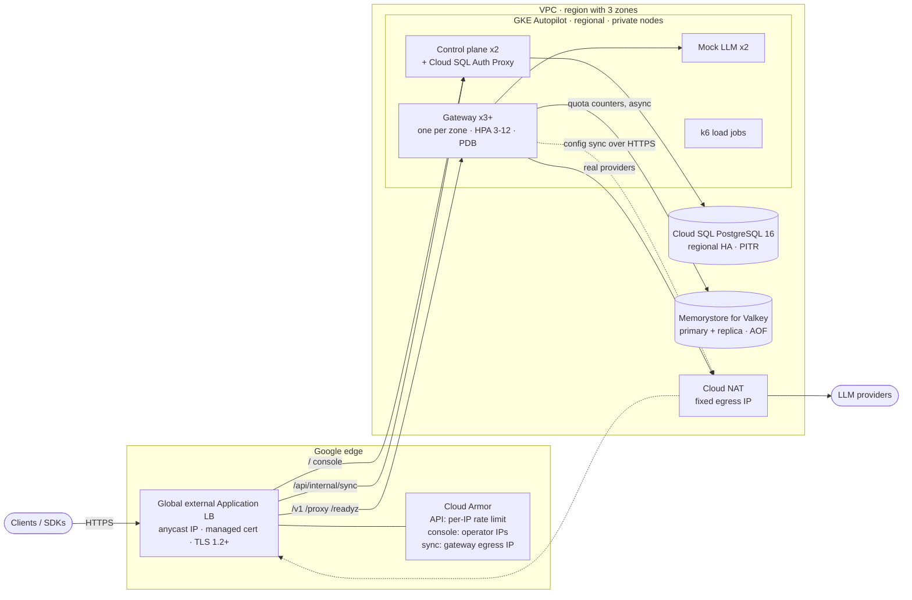

# GCP reference deployment

A complete, highly available Stratum environment on Google Cloud, built to
**prove the HA design under failure** and to be torn down the same day. It
reproduces the production topology at the smallest size that keeps every
failure mode real: three zones, managed databases with standbys, the real
edge. Cost is kept low by time (create, test, destroy), not by removing
redundancy.

- **Cost:** about **US$0.45–0.55 per hour** in `us-central1` while it runs,
  so a full test day is roughly **US$4–5**. Left running for a month it would
  be about US$330–400: run `make down` when you finish.
- **Time:** `make up` ~25 min, `make deploy` ~15–20 min (plus up to 45 min
  for the first TLS certificate, overlapped), `make test` ~45 min.

## What gets deployed



| Layer | Choice | Why |
|---|---|---|
| Compute | GKE **Autopilot**, regional | Google operates and hardens the nodes; billed per pod request; control plane replicated across zones (99.95% SLA), pods across zones covered (99.9% SLA). |
| Edge | Global external Application LB via **Gateway API** | Anycast IP, Google-managed certificate, 99.99% SLA, Cloud Armor; same front door a multi-region (Enterprise) setup would use. |
| TLS | Certificate Manager, load-balancer authorization | No DNS needed: the hostname defaults to `<edge-ip>.sslip.io`. Set `domain` to use your own. |
| WAF | Cloud Armor, **no OWASP signatures on the API** | Prompts contain SQL, shell and HTML; signature rules would block real traffic. Content inspection is the gateway's job. Rate limiting per IP at the edge; console and sync endpoints are allowlisted. |
| Control plane DB | Cloud SQL PostgreSQL 16, regional HA, PITR, private IP | Synchronous standby in another zone, automatic failover, backups. Reached through the Auth Proxy (mTLS + IAM). |
| Quota store | Memorystore for Valkey, cluster mode disabled, 1 replica, AOF, `noeviction` | Zone-redundant with automatic failover and a stable endpoint; counters survive restarts and are never evicted. Not on the request path (ADR-0004). |
| Egress | Cloud NAT with a static IP | Nodes have no public IPs. One known address to give to providers or customers that allowlist callers. |
| Identity | Workload Identity Federation | No service account keys anywhere. The gateway needs no Google permissions at all. |
| Secrets | Secret Manager → Kubernetes secrets | Generated once by the scripts; never in Terraform state or in git. |
| Images | Cloud Build → Artifact Registry, deployed **by digest** | Built from this checkout; what runs is exactly what was built. |
| Observability | Managed Service for Prometheus, Cloud Monitoring alerts, uptime checks | Multi-window SLO burn-rate alerts (99.99%), staleness and quota-store alerts, black-box check through the whole edge. |
| Cost guardrail | Optional billing budget | Alerts at 50/90/100% of `budget_amount_usd`. |

The **gateway syncs its configuration over the public HTTPS endpoint**, as a
customer's gateway would against a managed control plane, and that endpoint
only accepts the environment's NAT address. The **demo users' published API
keys are replaced** at bootstrap; an internet-facing environment must never
accept them.

## Cost breakdown (us-central1, on-demand, per hour)

| Item | Sizing | US$/h |
|---|---|---|
| GKE cluster fee | 1 Autopilot cluster | 0.100 (0 if it is the only Autopilot/zonal cluster on the billing account: free tier) |
| GKE pods | gateway 3×(0.25 vCPU, 0.5 GiB), control plane 2×(0.5, 1 GiB), mock 2×(0.25, 0.5 GiB) | ~0.12 |
| Cloud SQL | db-custom-1-3840, regional HA, 10 GB SSD | ~0.14 |
| Memorystore for Valkey | 2 × shared-core-nano + AOF | ~0.065 |
| Load balancer | 2 forwarding rules (80, 443) | 0.05 |
| Cloud Armor | 3 policies, 7 rules | ~0.03 |
| Cloud NAT | gateway + IP + data | ~0.015 |
| **Total** | | **~0.42–0.52** |

One-off: Cloud Build ~US$0.15 per build; k6 jobs ~US$0.05/h while running.
Logging, monitoring, Secret Manager and Artifact Registry stay within free
tiers at this volume. Cheaper still (but without the failover tests):
`cloudsql_ha = false` and `valkey_replicas = 0` bring it to ~US$0.32/h.

## Run it

Use **Cloud Shell** (it already has `gcloud`, `kubectl`, `helm`, `jq`,
`envsubst` and is authenticated). A **dedicated project** is strongly
recommended: deleting it guarantees nothing is left billing.

### Before you start: Terraform

Cloud Shell no longer ships Terraform. Its `terraform` command is a
placeholder that prints install instructions and exits with success, so the
scripts check `terraform version` and stop if it is not real. Install it once
(the home directory persists between sessions):

```sh
TF_VERSION=1.16.6
curl -sSLo /tmp/tf.zip "https://releases.hashicorp.com/terraform/${TF_VERSION}/terraform_${TF_VERSION}_linux_amd64.zip"
mkdir -p ~/bin && unzip -o /tmp/tf.zip terraform -d ~/bin && rm /tmp/tf.zip
export PATH="$HOME/bin:$PATH"   # new Cloud Shell sessions add ~/bin by themselves
terraform version               # must print "Terraform v1.x", not install steps
```

OpenTofu works too: `TF=tofu make up`.

```sh
# Once: a project with billing
gcloud projects create stratum-test-$RANDOM --name="Stratum HA test"
gcloud billing projects link <project> --billing-account=<XXXXXX-XXXXXX-XXXXXX>
gcloud config set project <project>

git clone https://github.com/getstratum/stratum && cd stratum/deploy/gcp

# On your laptop, not in Cloud Shell: curl -s ifconfig.me  -> your IP
PROJECT_ID=<project> CONSOLE_CIDR=<your-ip>/32 make up
make deploy                 # OPENAI_API_KEY=... make deploy  also registers a real provider

# SLO alerts: Cloud Monitoring rejects a PromQL alert on a metric that has
# never been written, so they are created only now that the gateway exports
# metrics. Set metric_alerts = true in terraform/terraform.tfvars, then:
make up                     # about a minute

make test                   # or make test-smoke, test-quota, test-rollout, ...
make keys                   # API keys and console login
make down
```

## Test plan

| Scenario | What happens | Pass criterion (failures caused by Stratum; see below) |
|---|---|---|
| `smoke` | Unary and streamed completions through the edge; unknown key; published demo key; http→https; console from a non-allowlisted IP | 200 / stream completes / 401 / 401 / 301 / 403 |
| `quota` | 80 requests with a team limited to 3000 tokens (30 × 100) across all replicas | 28–40 accepted (per-replica counters would accept up to 30 × replicas) |
| `rollout` | `kubectl rollout restart` of every gateway pod under 40 req/s (30% streams) | **0 failed requests**, 0 broken streams |
| `zone` | Delete every gateway pod in one zone under load (graceful) | 0 failed requests |
| `scripts/test.sh zone --hard` | Same, with `--grace-period=0 --force` | Only requests in flight on the killed pods fail |
| `valkey` | NetworkPolicy cuts gateways off from Valkey for 90 s under load | 0 failed requests; outage detected in metrics; 0 pending tokens after recovery |
| `cp-outage` | Control plane scaled to 0 under load; one gateway pod restarted meanwhile | 0 failed requests; the replacement pod starts from the snapshot copy in Valkey and becomes ready during the outage (ADR-0008) |
| `sql-failover` | `gcloud sql instances failover` under load | 0 failed gateway requests; control plane serving again afterwards |

Results are appended to `deploy/gcp/.results/<date>.md`. Load comes from k6
inside the cluster but goes through the public hostname, so DNS, TLS, the
load balancer and Cloud Armor are part of every measurement.

### Reading the results

Going through the real edge means some failures are not Stratum's. Every
failed request is attributed to whoever produced it, and the verdict counts
only the gateway's:

| Counted as | How it is recognised | Verdict |
|---|---|---|
| **Stratum** | The response carries `X-Stratum-Request-Id` (the gateway sets it on everything it answers) and is a 5xx or unexpected status, or a 200 stream that ends without `[DONE]` | Must be within the scenario's limit (0 for most) |
| **Edge** | An HTTP error without that header: the load balancer or Cloud Armor answered | Reported; flagged above `PATH_MAX_RATE` (0.1%) |
| **Network** | No HTTP response at all (connection reset, timeout) on the path k6 → Cloud NAT → load balancer; the load balancer never logs these | Same as edge |

When anything fails, the test prints the load balancer's own log of `/v1/`
errors for that run grouped by `statusDetails` (`response_sent_by_backend`
means the gateway answered; `retriable_error`, `failed_to_pick_backend` or
no details mean the load balancer did) and how to list each failure with its
timestamp: `kubectl -n stratum logs job/k6-<scenario> | grep K6_FAILURE`.

In the first full run ([report](../../docs/testing/gcp-2026-10-14.md); October
2026, 69,605 requests across rollout, zone, Valkey, control plane and database
failures) Stratum produced 0 errors; the load balancer and the NAT path
produced 31 between them, the largest share (27) during one rolling restart.
The same run showed that a gateway pod replaced during a control plane outage
could not start (2 of 3 ready). ADR-0008 closes that gap, and `cp-outage` now
checks it.

That is why end-to-end availability at 99.99% also needs **clients that
retry** connection errors and 5xx before the first byte. The official OpenAI
SDKs do by default (two retries with backoff); a custom client should too.
A stream that already started cannot be retried transparently.

What this cannot test: a real zone outage (Autopilot does not let you cordon
Google's nodes; the `zone` scenario removes the pods instead) and a regional
outage (out of scope for a single-region topology; that is the multi-region
Enterprise design).

## Troubleshooting

| Symptom | Cause and fix |
|---|---|
| `make deploy` waits on the certificate | Normal for 15–60 min the first time. After `CERT_WAIT_MINUTES` the gateways sync in-cluster; re-run `SKIP_BUILD=1 IMAGE_TAG=<tag> make deploy` once `make status` shows `ACTIVE`. |
| LB returns `502 failed_to_connect_to_backend` | Check `kubectl -n stratum get pods`; if pods are ready, the NetworkPolicy may not match your LB's source ranges: `kubectl -n stratum delete networkpolicy --all` to confirm. |
| Pods stuck in `ImagePullBackOff` on the Auth Proxy | Set `PROXY_IMAGE` to a current `gcr.io/cloud-sql-connectors/cloud-sql-proxy:2.x` tag and re-run `make deploy`. |
| Console returns 403 | Your IP changed; update `console_allowed_cidrs` and `make up`. |
| `make down` fails on the network | Leftover NEGs from the Gateway controller; the script removes them and retries. If it still fails, delete the project. |
| Uptime alert fires right after `make up` | Expected: the check exists before the load balancer and certificate do. It clears once `make deploy` finishes and the certificate is active. |
| Cloud Build fails with "buildx component is missing" | Build in Cloud Shell instead: `BUILD_WITH=docker make deploy`. |
| Quota test fails at the first request | The month's quota was already used: `make test-quota-reset`. |

## Before production

This environment is production-shaped, not production-ready. The gaps, in
priority order:

1. **Valkey transport security.** In-transit encryption and IAM/token auth
   need CA-bundle and token support in the gateway's Valkey client. Today
   Valkey is reachable only inside the VPC through Private Service Connect.
   The snapshot copy the gateways keep there (ADR-0008) is encrypted by the
   gateway itself, but quota counters are not, and the link should be.
2. **Control plane.** Real multi-organisation scoping (no `DEMO_ORG`), RBAC on
   instance and provider registration, IAP or SSO in front of the console,
   no seeded demo users.
3. **Supply chain.** Images from the signed release pipeline instead of an
   ad-hoc Cloud Build; Binary Authorization; third-party images pinned by
   digest.
4. **State and secrets.** Terraform state in a GCS backend
   (`backend.tf.example`), External Secrets Operator or the Secret Manager
   add-on instead of script-created Kubernetes secrets, application-layer
   secret encryption with Cloud KMS.
5. **Sizing.** Valkey `STANDARD_SMALL` or larger, Cloud SQL sized for real
   log volume, `minReplicas` set so two zones carry peak traffic.
6. **Database IAM authentication** for the control plane (no password).
